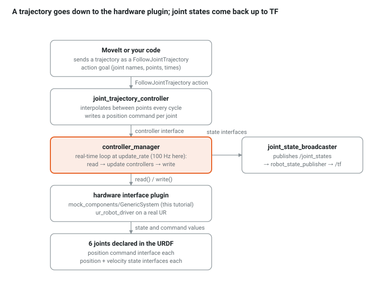

# Ch 5 — ros2_control + mock hardware: making the robot move (week 3)

Goal: replace the slider GUI with the real control stack. By the end, a `FollowJointTrajectory` goal moves the UR10e in RViz through the same controller MoveIt will use, with a mock hardware plugin instead of a UR driver.

## The stack



Only the plugin changes between this tutorial and a real robot. Everything above it is identical, which is why a mocked cell is a faithful rehearsal.

## 10-minute proof with the UR driver's own mock mode

```bash
ros2 launch ur_robot_driver ur_control.launch.py ur_type:=ur10e robot_ip:=0.0.0.0 \
  use_mock_hardware:=true initial_joint_controller:=joint_trajectory_controller launch_rviz:=true
# second terminal: the driver's demo trajectory
ros2 launch ur_robot_driver test_joint_trajectory_controller.launch.py
ros2 control list_controllers
ros2 control list_hardware_interfaces
```

`robot_ip` is mandatory but unused in mock mode; the scaled controller needs the real robot, so the plain `joint_trajectory_controller` is selected. Watch the arm move, then stop everything: we now build the same thing for our cell by hand.

## Declare the hardware in Xacro: `urdf/cell_control.urdf.xacro`

```xml
<?xml version="1.0"?>
<robot name="cell" xmlns:xacro="http://wiki.ros.org/xacro">
  <xacro:include filename="$(find cell_description)/urdf/cell.urdf.xacro"/>

  <xacro:macro name="ctrl_joint" params="name init">
    <joint name="${name}">
      <command_interface name="position"/>
      <state_interface name="position"><param name="initial_value">${init}</param></state_interface>
      <state_interface name="velocity"/>
    </joint>
  </xacro:macro>

  <ros2_control name="ur10e_system" type="system">
    <hardware>
      <plugin>mock_components/GenericSystem</plugin>   <!-- state = command, instantly -->
    </hardware>
    <!-- a good "home": elbow bent, tool pointing down, in front of the robot -->
    <xacro:ctrl_joint name="shoulder_pan_joint"  init="0.0"/>
    <xacro:ctrl_joint name="shoulder_lift_joint" init="-1.57"/>
    <xacro:ctrl_joint name="elbow_joint"         init="1.57"/>
    <xacro:ctrl_joint name="wrist_1_joint"       init="-1.57"/>
    <xacro:ctrl_joint name="wrist_2_joint"       init="-1.57"/>
    <xacro:ctrl_joint name="wrist_3_joint"       init="0.0"/>
  </ros2_control>
</robot>
```

## Configure the controllers: `config/ros2_controllers.yaml`

```yaml
controller_manager:
  ros__parameters:
    update_rate: 100
    joint_state_broadcaster:
      type: joint_state_broadcaster/JointStateBroadcaster
    arm_controller:
      type: joint_trajectory_controller/JointTrajectoryController

arm_controller:
  ros__parameters:
    joints: [shoulder_pan_joint, shoulder_lift_joint, elbow_joint, wrist_1_joint, wrist_2_joint, wrist_3_joint]
    command_interfaces: [position]
    state_interfaces: [position, velocity]
    state_publish_rate: 100.0
    action_monitor_rate: 20.0
    allow_partial_joints_goal: false
    constraints:
      stopped_velocity_tolerance: 0.01
      goal_time: 0.0            # 0 = no deadline; a real cell sets this
```

## Launch: `launch/control.launch.py`

```python
from launch import LaunchDescription
from launch.substitutions import Command, FindExecutable, PathJoinSubstitution
from launch_ros.actions import Node
from launch_ros.parameter_descriptions import ParameterValue
from launch_ros.substitutions import FindPackageShare

def generate_launch_description():
    pkg = FindPackageShare('cell_description')
    xacro_file = PathJoinSubstitution([pkg, 'urdf', 'cell_control.urdf.xacro'])
    robot_description = ParameterValue(Command([FindExecutable(name='xacro'), ' ', xacro_file]), value_type=str)
    controllers = PathJoinSubstitution([pkg, 'config', 'ros2_controllers.yaml'])
    return LaunchDescription([
        Node(package='robot_state_publisher', executable='robot_state_publisher',
             parameters=[{'robot_description': robot_description}]),
        # ros2_control_node reads the URDF from the /robot_description topic in Jazzy
        Node(package='controller_manager', executable='ros2_control_node', parameters=[controllers], output='screen',
             remappings=[('~/robot_description', '/robot_description')]),
        Node(package='controller_manager', executable='spawner', arguments=['joint_state_broadcaster']),
        Node(package='controller_manager', executable='spawner', arguments=['arm_controller']),
        Node(package='rviz2', executable='rviz2', arguments=['-d', PathJoinSubstitution([pkg, 'rviz', 'cell.rviz'])]),
    ])
```

Add `config` to the `install(DIRECTORY …)` line and `<exec_depend>` on `controller_manager`, `joint_state_broadcaster`, `joint_trajectory_controller`, `ros2_control`.

## Run and command a trajectory

```bash
colcon build --symlink-install && source install/setup.bash
ros2 launch cell_description control.launch.py
ros2 control list_controllers          # both should be "active"
ros2 topic hz /joint_states            # ~100 Hz

ros2 action send_goal /arm_controller/follow_joint_trajectory control_msgs/action/FollowJointTrajectory "{
  trajectory: {
    joint_names: [shoulder_pan_joint, shoulder_lift_joint, elbow_joint, wrist_1_joint, wrist_2_joint, wrist_3_joint],
    points: [
      {positions: [0.8, -1.3, 1.4, -1.67, -1.57, 0.0], time_from_start: {sec: 3}},
      {positions: [0.0, -1.57, 1.57, -1.57, -1.57, 0.0], time_from_start: {sec: 6}}
    ]}}" --feedback
```

The arm sweeps to the pallet side and back over 6 s. The controller interpolates between the two points; the mock plugin copies each command into the state; the broadcaster publishes it; RViz draws it.

## Checkpoint

- [ ] `ros2 control list_hardware_interfaces` shows 6 command interfaces (claimed) and 12 state interfaces (available)
- [ ] The trajectory above moves the robot; a goal with a joint beyond its URDF limit is rejected (try `shoulder_pan_joint: 7.0`)
- [ ] You wrote `ros2_basics/src/traj_client.cpp`, an `rclcpp_action::Client<control_msgs::action::FollowJointTrajectory>` that sends the same two points and prints the result's `error_code`
- [ ] You changed `update_rate` to 500 and observed `/joint_states` rate change

## Questions

1. Why does `arm_controller` need `state_interfaces: [position, velocity]` when the mock only tracks position?
2. What would a Gazebo plugin change in the stack drawing above?

Answers: [Appendix](appendix.html)

## Go deeper

- [Writing a hardware component](https://docs.ros.org/en/jazzy/p/hardware_interface/doc/writing_new_hardware_component.html): what the mock plugin hides. A hardware plugin is a C++ class with `on_init`, `read()` and `write()`; the controller manager calls read and write every cycle. [Demo example 7](https://control.ros.org/jazzy/doc/api/classros2__control__demo__example__7_1_1RobotSystem.html) is a six-axis arm with its own plugin and controller, the closest open example to a vendor driver.
- [UR custom workcell tutorial, driver part](https://docs.universal-robots.com/Universal_Robots_ROS2_Documentation/doc/ur_tutorials/my_robot_cell/doc/start_ur_driver.html): the vendor adds `ur_ros2_control` to a custom description and starts `ur_control.launch.py` with `description_launchfile`, in mock or real mode. This is the path from this chapter to a real UR in Ch 18.
- Exercise for later: write a `cell_hardware` plugin that forwards joint commands to `world_model` over a socket instead of the mock. Nothing above the plugin changes, which is the point of the drawing at the top of this chapter.
