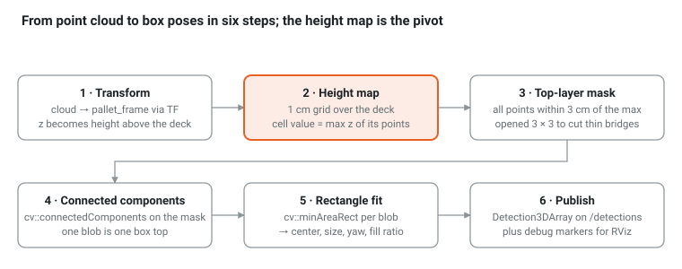

# Ch 10 — Box detection with height maps (week 6)

Goal: a `box_detector` node that turns `/camera/points` into `vision_msgs/Detection3DArray` in `pallet_frame`: one detection per visible top-layer box with center, size, yaw and a confidence. No learning, no PCL; a height map, a mask, connected components and a rectangle fit.

## Why a height map

A top-down camera over a pallet produces a 2.5D scene: for every (x, y) on the deck there is one visible height. Rasterizing the cloud into a 1 cm grid of maximum z turns a 20k-point cloud into a 100 × 80 image you can treat with image tools. The same height map tells the palletizer in Ch 15 where the surface is. It is the central data structure of this tutorial, and of most industrial depalletizing systems.



Steps 3–5 run only on the highest layer; after those boxes are removed, the next capture reveals the next layer. Depalletizing is a loop of capture → detect → pick.

## Gaps matter

Two boxes touching at the same height form one blob. Real pallets have gaps and rounded edges that a camera sees as depth discontinuities; the mock has to make gaps explicit. `spawn_scene.py` (Ch 8) places single-SKU boxes with 2 cm gaps for this reason, and SKU A is 0.30 × 0.18 × 0.15 m so three fit across the 0.6 m deck with gaps.

## The detector as a pure function: `cell_perception/include/cell_perception/heightmap.hpp`

The math lives in a header with no ROS in it (OpenCV for the image steps, Eigen for points), so GoogleTest can run it on a synthetic scene; the node below only converts messages.

```bash
cd ~/pal_ws/src && ros2 pkg create --build-type ament_cmake cell_perception \
  --dependencies rclcpp sensor_msgs vision_msgs visualization_msgs tf2_ros tf2_eigen cell_planning
mkdir -p cell_perception/include/cell_perception cell_perception/src cell_perception/test
```

```cpp
#pragma once
#include <algorithm>
#include <cmath>
#include <limits>
#include <vector>
#include <Eigen/Core>
#include <opencv2/core.hpp>
#include <opencv2/imgproc.hpp>

namespace cell_perception {

struct Params {
  double cell = 0.01, deck_x = 0.8, deck_y = 0.6, margin = 0.1;   // 1 cm grid over the deck plus a margin
  double layer_tol = 0.03, min_area = 0.015, min_height = 0.03;
};

struct Detection { double x, y, z_top, h, sx, sy, yaw, fill; };

/// Fill enclosed holes of a 0/255 mask: flood the outside, whatever is left unflooded is a hole.
inline void fillHoles(cv::Mat & mask) {
  cv::Mat inv = ~mask, padded;
  cv::copyMakeBorder(inv, padded, 1, 1, 1, 1, cv::BORDER_CONSTANT, 255);
  cv::floodFill(padded, cv::Point(0, 0), 0);
  mask |= padded(cv::Rect(1, 1, mask.cols, mask.rows));
}

/// Height map -> top-layer mask -> connected components -> rectangles. P: points in pallet_frame.
inline std::vector<Detection> detect(const std::vector<Eigen::Vector3d> & P, const Params & p = {}, cv::Mat * height_map = nullptr) {
  const int nx = std::lround((p.deck_x + 2 * p.margin) / p.cell), ny = std::lround((p.deck_y + 2 * p.margin) / p.cell);
  cv::Mat hm(ny, nx, CV_32F, cv::Scalar(0.0f));                                   // highest point per cell, rows = y
  cv::Mat lo(ny, nx, CV_32F, cv::Scalar(std::numeric_limits<float>::infinity()));  // lowest point per cell
  for (const auto & q : P) {
    const int ix = std::floor((q.x() + p.deck_x / 2 + p.margin) / p.cell);
    const int iy = std::floor((q.y() + p.deck_y / 2 + p.margin) / p.cell);
    if (ix < 0 || ix >= nx || iy < 0 || iy >= ny) continue;
    float & h = hm.at<float>(iy, ix); float & l = lo.at<float>(iy, ix);
    h = std::max(h, static_cast<float>(q.z())); l = std::min(l, static_cast<float>(q.z()));
  }
  if (height_map) *height_map = hm;
  double z_top; cv::minMaxLoc(hm, nullptr, &z_top);
  std::vector<Detection> out;
  if (z_top < p.min_height) return out;                                           // empty pallet

  const float top = static_cast<float>(z_top - p.layer_tol);
  cv::Mat mask = (hm > top) & (lo > top);           // a top cell has ALL its points at the top: edge and gap cells drop out
  fillHoles(mask);
  cv::morphologyEx(mask, mask, cv::MORPH_OPEN, cv::Mat::ones(3, 3, CV_8U));       // cut 1-cell bridges, drop specks
  cv::Mat labels;
  const int n = cv::connectedComponents(mask, labels, 4);

  for (int k = 1; k < n; ++k) {
    cv::Mat core = (labels == k);
    if (cv::countNonZero(core) * p.cell * p.cell < p.min_area) continue;
    cv::Mat blob; cv::dilate(core, blob, cv::Mat::ones(3, 3, CV_8U));              // give back the stripped edge cells
    std::vector<cv::Point> pts; cv::findNonZero(blob, pts);
    double yaw = std::remainder(cv::minAreaRect(pts).angle * M_PI / 180.0, M_PI / 2);   // orientation only, folded to (-45, 45]
    if (std::abs(yaw) < 3.0 * M_PI / 180.0) yaw = 0.0;                                // axis-aligned: a stray cell must not tilt it
    // size: project the cells onto the box axes and trim the 2 % outliers on each end, so one noisy row cannot stretch it
    std::vector<double> u, v;
    const double cs = std::cos(yaw), sn = std::sin(yaw);
    for (const auto & q : pts) { u.push_back(q.x * cs + q.y * sn); v.push_back(-q.x * sn + q.y * cs); }
    auto span = [](std::vector<double> & a) { std::sort(a.begin(), a.end()); const std::size_t k = a.size() / 50; return a[a.size() - 1 - k] - a[k]; };
    double sx = (span(u) + 1) * p.cell, sy = (span(v) + 1) * p.cell;              // +1: spans are between cell centers
    if (sx < sy) { std::swap(sx, sy); yaw += M_PI / 2; }                           // canonical: x is the long side
    yaw = std::remainder(yaw, M_PI);                                                // (-90 deg, 90 deg]
    const cv::Point2f center = cv::minAreaRect(pts).center;

    std::vector<cv::Point> core_pts; cv::findNonZero(core, core_pts);
    std::vector<float> z; for (const auto & c : core_pts) z.push_back(hm.at<float>(c));
    std::nth_element(z.begin(), z.begin() + z.size() / 2, z.end());
    const double z_top_k = z[z.size() / 2];

    cv::Mat ring; cv::dilate(blob, ring, cv::Mat::ones(7, 7, CV_8U)); ring &= ~blob;   // a 3 cm band around the box
    double z_bottom = 0.0;                                                          // nearest lower surface, else the deck
    for (int y = 0; y < ny; ++y) for (int x = 0; x < nx; ++x)
      if (ring.at<uint8_t>(y, x) && hm.at<float>(y, x) < z_top_k - p.layer_tol) z_bottom = std::max(z_bottom, double(hm.at<float>(y, x)));

    out.push_back({(center.x + 0.5) * p.cell - p.deck_x / 2 - p.margin, (center.y + 0.5) * p.cell - p.deck_y / 2 - p.margin,
                   z_top_k, z_top_k - z_bottom, sx, sy, yaw, cv::countNonZero(blob) * p.cell * p.cell / (sx * sy)});
  }
  return out;
}

}  // namespace cell_perception
```

## The node: `src/box_detector.cpp`

```cpp
#include <rclcpp/rclcpp.hpp>
#include <sensor_msgs/msg/point_cloud2.hpp>
#include <sensor_msgs/point_cloud2_iterator.hpp>
#include <vision_msgs/msg/detection3_d_array.hpp>
#include <visualization_msgs/msg/marker_array.hpp>
#include <tf2_ros/buffer.h>
#include <tf2_ros/transform_listener.h>
#include <cell_perception/heightmap.hpp>
#include <cell_planning/geometry.hpp>

using cell_planning::poseFromMat; using cell_planning::rotZ; using cell_planning::trans;

class BoxDetector : public rclcpp::Node {
public:
  BoxDetector() : Node("box_detector"), buf_(get_clock()), listener_(buf_) {
    p_.cell = declare_parameter("cell_m", 0.01);
    p_.layer_tol = declare_parameter("layer_tol_m", 0.03);
    p_.min_area = declare_parameter("min_area_m2", 0.015);
    p_.min_height = declare_parameter("min_height_m", 0.03);
    sub_ = create_subscription<sensor_msgs::msg::PointCloud2>("camera/points", rclcpp::SensorDataQoS(),
                                                               [this](sensor_msgs::msg::PointCloud2::ConstSharedPtr m) { onCloud(*m); });
    pub_ = create_publisher<vision_msgs::msg::Detection3DArray>("detections", 10);
    pub_dbg_ = create_publisher<visualization_msgs::msg::MarkerArray>("detections/markers", 10);
  }

private:
  void onCloud(const sensor_msgs::msg::PointCloud2 & msg) {
    Eigen::Isometry3d T;
    try {
      T = tf2::transformToEigen(buf_.lookupTransform("pallet_frame", msg.header.frame_id, tf2::TimePointZero));
    } catch (const tf2::TransformException & e) { RCLCPP_WARN(get_logger(), "%s", e.what()); return; }

    std::vector<Eigen::Vector3d> pts;
    pts.reserve(msg.width * msg.height);
    for (sensor_msgs::PointCloud2ConstIterator<float> it(msg, "x"); it != it.end(); ++it)
      pts.push_back(T * Eigen::Vector3d(it[0], it[1], it[2]));          // x, y, z are adjacent floats
    const auto dets = cell_perception::detect(pts, p_);

    vision_msgs::msg::Detection3DArray arr;
    arr.header.stamp = msg.header.stamp; arr.header.frame_id = "pallet_frame";
    visualization_msgs::msg::MarkerArray mk;
    visualization_msgs::msg::Marker clear; clear.action = visualization_msgs::msg::Marker::DELETEALL; mk.markers.push_back(clear);
    for (size_t i = 0; i < dets.size(); ++i) {
      const auto & d = dets[i];
      vision_msgs::msg::Detection3D det;
      det.header = arr.header; det.id = "det_" + std::to_string(i);
      det.bbox.center = poseFromMat(trans(d.x, d.y, d.z_top - d.h / 2) * rotZ(d.yaw));
      det.bbox.size.x = d.sx; det.bbox.size.y = d.sy; det.bbox.size.z = d.h;
      vision_msgs::msg::ObjectHypothesisWithPose hyp;
      hyp.hypothesis.class_id = "box"; hyp.hypothesis.score = std::min(1.0, d.fill);
      det.results.push_back(hyp);
      arr.detections.push_back(det);

      visualization_msgs::msg::Marker m;
      m.header = arr.header; m.ns = "det"; m.id = static_cast<int>(i);
      m.type = visualization_msgs::msg::Marker::CUBE; m.action = visualization_msgs::msg::Marker::ADD;
      m.pose = det.bbox.center; m.scale = det.bbox.size; m.color.g = 1.0f; m.color.a = 0.4f;
      mk.markers.push_back(m);
    }
    pub_->publish(arr); pub_dbg_->publish(mk);
  }

  cell_perception::Params p_;
  tf2_ros::Buffer buf_;
  tf2_ros::TransformListener listener_;
  rclcpp::Subscription<sensor_msgs::msg::PointCloud2>::SharedPtr sub_;
  rclcpp::Publisher<vision_msgs::msg::Detection3DArray>::SharedPtr pub_;
  rclcpp::Publisher<visualization_msgs::msg::MarkerArray>::SharedPtr pub_dbg_;
};

int main(int argc, char ** argv) {
  rclcpp::init(argc, argv);
  rclcpp::spin(std::make_shared<BoxDetector>());
  rclcpp::shutdown();
}
```

```cmake
# cell_perception/CMakeLists.txt
cmake_minimum_required(VERSION 3.8)
project(cell_perception)
set(CMAKE_CXX_STANDARD 17)

find_package(ament_cmake REQUIRED)
find_package(rclcpp REQUIRED)
find_package(sensor_msgs REQUIRED)
find_package(vision_msgs REQUIRED)
find_package(visualization_msgs REQUIRED)
find_package(tf2_ros REQUIRED)
find_package(tf2_eigen REQUIRED)
find_package(OpenCV REQUIRED COMPONENTS core imgproc)
find_package(cell_planning REQUIRED)

add_executable(box_detector src/box_detector.cpp)
target_include_directories(box_detector PUBLIC include)
ament_target_dependencies(box_detector rclcpp sensor_msgs vision_msgs visualization_msgs tf2_ros tf2_eigen)
target_link_libraries(box_detector cell_planning::cell_planning ${OpenCV_LIBS})
install(TARGETS box_detector DESTINATION lib/${PROJECT_NAME})
install(DIRECTORY include/ DESTINATION include)

if(BUILD_TESTING)
  find_package(ament_cmake_gtest REQUIRED)
  ament_add_gtest(test_detect test/test_detect.cpp)
  target_include_directories(test_detect PUBLIC include)
  target_link_libraries(test_detect ${OpenCV_LIBS})
endif()
ament_package()
```

```cpp
// test/test_detect.cpp: the detector on a synthetic single-SKU scene (same recipe as the mock camera)
#include <random>
#include <gtest/gtest.h>
#include <cell_perception/heightmap.hpp>

static void face(std::vector<Eigen::Vector3d> & P, double cx, double cy, double sx, double sy, double z, double step = 0.005) {
  for (double u = -sx / 2; u <= sx / 2 + 1e-9; u += step)
    for (double v = -sy / 2; v <= sy / 2 + 1e-9; v += step) P.emplace_back(cx + u, cy + v, z);
}

TEST(Detect, SixBoxesWithGaps) {
  std::vector<std::pair<double, double>> boxes;
  for (double x : {-0.16, 0.16}) for (double y : {-0.2, 0.0, 0.2}) boxes.emplace_back(x, y);
  std::vector<Eigen::Vector3d> P;
  face(P, 0, 0, 0.8, 0.6, 0.0);                                   // the deck
  for (auto [x, y] : boxes) face(P, x, y, 0.30, 0.18, 0.15);       // six box tops
  std::vector<Eigen::Vector3d> visible;
  std::mt19937 rng(0); std::normal_distribution<double> noise(0.0, 0.002);
  for (const auto & q : P) {                                       // hide deck points under the boxes
    bool hidden = false;
    for (auto [x, y] : boxes) hidden |= std::abs(q.x() - x) < 0.15 - 1e-6 && std::abs(q.y() - y) < 0.09 - 1e-6 && q.z() < 0.149;
    if (!hidden) visible.push_back(q + Eigen::Vector3d(noise(rng), noise(rng), noise(rng)));
  }
  const auto dets = cell_perception::detect(visible);
  ASSERT_EQ(dets.size(), 6u);
  for (const auto & d : dets) {
    EXPECT_NEAR(d.sx, 0.30, 0.011); EXPECT_NEAR(d.sy, 0.18, 0.011); EXPECT_NEAR(d.z_top, 0.15, 0.01);
    double best = 1.0;
    for (auto [x, y] : boxes) best = std::min(best, std::hypot(d.x - x, d.y - y));
    EXPECT_LT(best, 0.008);                                        // half a cell per axis
  }
}
```

Two rules carry this detector. The **all-points-at-top** rule (`lo > top`) throws away every cell that mixes a box edge with the deck or with a gap, so two boxes 1 cm apart stay apart; a 3 × 3 opening then cuts any single-cell bridge noise leaves behind. The height `h` comes from the nearest lower surface in a 3 cm ring: correct whenever a gap or a step exposes a lower surface (the gapped pallet, the mixed scene), wrong on a tight full layer where the ring sees only the deck, in which case `h` is the stack height. Ch 13 cross-checks `h` against the SKU table.

## Run

```bash
ros2 launch cell_moveit_config demo.launch.py
ros2 launch cell_sim twin.launch.py
ros2 run cell_perception box_detector
ros2 run cell_sim spawn_scene --scene single_sku --layers 2
ros2 topic echo /detections --once | grep -A3 size      # six detections, size ~0.30 x 0.18
ros2 run cell_sim spawn_scene --scene mixed
ros2 topic echo /detections --once                       # one detection: the A box on top of C (highest layer)
```

In RViz add **MarkerArray** on `/detections/markers`: green translucent boxes should sit on the orange ones.

## Evaluate it like a vision engineer

Write `cell_perception/src/eval_detector.cpp`: subscribe to `/detections` and `camera/ground_truth` (Ch 9 checkpoint), transform the truth boxes into `pallet_frame`, match each detection to the nearest truth box, and log mean |Δxy|, |Δyaw| and |Δsize|. Expected with 2 mm noise: position error within one cell (up to 5 mm per axis, 7 mm in the plane), size error under one cell, yaw error under 2° for rectangles with sides ≥ 0.18 m.

| Failure | Symptom | Knob |
| --- | --- | --- |
| Two boxes merge | one detection 0.30 × 0.38, fill ≈ 0.9 | the gap is narrower than the point spacing: no deck point lands in the gap cell |
| One box splits | two thin detections | `min_area_m2`, or noise above 5 mm (see the checkpoint) |
| Lower layer leaks in | extra detections at the wrong z | `layer_tol_m` must stay well below the box height |
| Sizes one cell off | consistent ±1 cm | the trimmed projection and the `+1` cell term; rotated boxes read up to 1.5 cm large |

## Checkpoint

- [ ] `single_sku --layers 2` gives 6 detections within one cell (1 cm) in size and position against ground truth
- [ ] After `grip_demo` removes one box, a new capture yields 5 detections, and after the whole layer is gone the next capture yields the 6 lower boxes
- [ ] A spawned box rotated by 30° (`trans(…) @ rot('z', 0.52)` in `spawn_scene`) is detected with yaw ≈ 0.52 (±2°) and the long side as `size.x`
- [ ] `noise_sigma_m:=0.004` still gives 6 clean detections; at 0.006 the sizes collapse and at 0.010 nothing is found. Explain which rule fails first (the all-points-at-top rule: max − min inside a cell is about 6σ, which exceeds `layer_tol_m` at σ ≈ 5 mm)

## Questions

1. Why detect only the top layer rather than every visible box?
2. The fill ratio is 0.6 for one detection. What shape is the blob?

Answers: [Appendix](appendix.html)

## Go deeper

- When the gaps disappear: [Monica, Aleotti and Lodi Rizzini (IRC 2020)](https://www.ce.unipr.it/~rizzini/papers/monica20irc.pdf) detect tightly packed parcels from a ToF camera by combining edges from the intensity image with depth discontinuities, then fitting box hypotheses. That is the real-camera replacement for the all-points-at-top rule, which needs a visible gap or step.
- [Zivid, application requirements for (de)palletization](https://support.zivid.com/en/latest/camera/academy/applications/depalletization/application-requirements.html): which box features a camera must see (edges, tape, labels, shrink wrap) and how data quality interacts with gripper compliance. Read it before tuning any detector on real data.
- Vendors solve the hardest cases (plastic-wrapped, black, glossy boxes) with a 2D color image plus the point cloud and often a learned segmenter; the height map stays the first stage of most pipelines.
