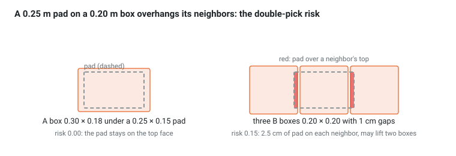

# Ch 11 — Pick planning and the planning scene (week 7)

Goal: turn a detection into a grasp (`cell_planning/grasps.hpp`), run the eight-stage pick-and-place as a ROS 2 action (`pick_place_server`), and keep MoveIt's planning scene honest: boxes are obstacles until one is attached to the gripper. At the end, the first vision-guided pick.

## From detection to TCP pose

| Decision | Rule in this tutorial | Why |
| --- | --- | --- |
| Where | TCP at the top-face center, z into the box (`topDownTcp`) | suction works on the top face; the pad is symmetric |
| Yaw | pad long side (0.25) along the box long side; two candidates, yaw and yaw + 180° | maximal seal area; the wrist can reach either |
| Overhang | pad may stick out, but not onto a neighbor at the same height | an overhanging pad lifts two boxes: the classic double pick |
| Which first | highest top, then nearest to the robot | nothing rests on it; shortest path |
| Approach | 0.15 m above the grasp along the TCP z, then a straight descend | lets the planner find a free-space path, then a predictable contact move |



`doublePickRisk` samples the pad footprint at 1 cm and counts the samples that land on another box's top face at the same height; the red strips are those samples.

## `cell_planning/include/cell_planning/grasps.hpp`

```cpp
#pragma once
#include <array>
#include <cmath>
#include <utility>
#include <vector>
#include <cell_planning/geometry.hpp>

namespace cell_planning {

struct BoxSize { double x, y, z; };
using Neighbor = std::pair<Isometry3d, BoxSize>;                 // (pose of the box center, its size)
constexpr std::array<double, 2> PAD = {0.25, 0.15};              // suction pad footprint x, y [m] (Ch 3)

/// Top-down TCP poses for a box: pad along the long side, both yaws, TCP z into the box.
inline std::vector<Isometry3d> graspCandidates(const Isometry3d & T_box, const BoxSize & size) {
  const Isometry3d T_top = T_box * trans(0.0, 0.0, size.z / 2);
  const double align = size.x >= size.y ? 0.0 : M_PI / 2;
  return {T_top * rotZ(align) * rotX(M_PI), T_top * rotZ(align + M_PI) * rotX(M_PI)};
}

/// Sample points of the pad face, expressed in the frame T_tcp is given in.
inline std::vector<Eigen::Vector3d> padPoints(const Isometry3d & T_tcp, double step = 0.01) {
  std::vector<Eigen::Vector3d> P;
  for (double x = -PAD[0] / 2; x <= PAD[0] / 2 + 1e-9; x += step)
    for (double y = -PAD[1] / 2; y <= PAD[1] / 2 + 1e-9; y += step) P.push_back(T_tcp * Eigen::Vector3d(x, y, 0.0));
  return P;
}

/// Does a point lie on the top face of a box? (tested in the box's own frame)
inline bool insideTop(const Eigen::Vector3d & p, const Isometry3d & T_box, const BoxSize & s, double z_tol = 0.02) {
  const Eigen::Vector3d l = T_box.inverse() * p;
  return std::abs(l.x()) <= s.x / 2 && std::abs(l.y()) <= s.y / 2 && std::abs(l.z() - s.z / 2) <= z_tol;
}

/// Fraction of the pad resting on other boxes whose top is at the pad height.
inline double doublePickRisk(const Isometry3d & T_tcp, const std::vector<Neighbor> & neighbors) {
  const auto P = padPoints(T_tcp);
  std::size_t hits = 0;
  for (const auto & p : P)
    for (const auto & [T_n, s_n] : neighbors)
      if (insideTop(p, T_n, s_n)) { ++hits; break; }
  return static_cast<double>(hits) / static_cast<double>(P.size());
}

/// (risk, T_tcp): lowest double-pick risk, then least wrist rotation from the current TCP if one is given.
inline std::pair<double, Isometry3d> bestGrasp(const Isometry3d & T_box, const BoxSize & size,
                                               const std::vector<Neighbor> & neighbors,
                                               const Isometry3d * T_tcp_now = nullptr) {
  std::pair<double, Isometry3d> best{2.0, Isometry3d::Identity()};
  double best_turn = 1e9;
  for (const auto & T : graspCandidates(T_box, size)) {
    const double risk = std::round(doublePickRisk(T, neighbors) * 1000.0) / 1000.0;
    const double turn = T_tcp_now ? std::abs(std::remainder(yawOf(T) - yawOf(*T_tcp_now), 2 * M_PI)) : 0.0;
    if (risk < best.first || (risk == best.first && turn < best_turn)) { best = {risk, T}; best_turn = turn; }
  }
  return best;
}

}  // namespace cell_planning
```

```cpp
// cell_planning/test/test_grasps.cpp   (add `ament_add_gtest(test_grasps test/test_grasps.cpp)` + link to CMakeLists.txt)
#include <gtest/gtest.h>
#include <cell_planning/grasps.hpp>

using namespace cell_planning;
static const BoxSize A{0.30, 0.18, 0.15}, B{0.20, 0.20, 0.12};

TEST(Grasps, LoneBoxHasNoRisk) {
  const auto [risk, T] = bestGrasp(trans(0, 0, 0.075), A, {});
  EXPECT_EQ(risk, 0.0);
  EXPECT_TRUE(T.translation().isApprox(Eigen::Vector3d(0, 0, 0.15)));
}

TEST(Grasps, SmallBoxBetweenNeighborsIsRisky) {
  const std::vector<Neighbor> neighbors{{trans(0.21, 0, 0.06), B}, {trans(-0.21, 0, 0.06), B}};   // 1 cm gaps left and right
  const auto [risk, T] = bestGrasp(trans(0, 0, 0.06), B, neighbors);
  EXPECT_GT(risk, 0.0);                       // the 0.25 pad overhangs a 0.20 box by 2.5 cm each side
}

TEST(Grasps, CandidatesPointDown) {
  for (const auto & T : graspCandidates(trans(0, 0, 0.075), A))
    EXPECT_TRUE(T.linear().col(2).isApprox(Eigen::Vector3d(0, 0, -1)));
}
```

## The planning scene: obstacles, attached objects, and contact

Three facts drive the server design:

1. Every detected box must be a collision object, or the arm plans through the stack.
2. A planner cannot plan **contact**: the grasp pose has the pad touching the box top, which is a collision. Remove the target box from the scene right before the descend; it becomes an attached object after the grip.
3. An attached object moves with the link it is attached to and is checked against the world, so a carried box cannot be dragged through the conveyor edge. `touch_links` tells MoveIt which links may touch it (the pad).

Nothing to add to `Robot` (Ch 7): `moveLinear` already asks `computeCartesianPath` to check collisions (`avoid_collisions = true`), so straight-line moves respect the scene too.

## `cell_motion/src/pick_place_server.cpp`

```cpp
#include <chrono>
#include <memory>
#include <mutex>
#include <string>
#include <thread>
#include <rclcpp/rclcpp.hpp>
#include <rclcpp_action/rclcpp_action.hpp>
#include <moveit/planning_scene_interface/planning_scene_interface.hpp>
#include <moveit_msgs/msg/collision_object.hpp>
#include <shape_msgs/msg/solid_primitive.hpp>
#include <cell_interfaces/action/pick_place.hpp>
#include <cell_interfaces/srv/set_suction.hpp>
#include <cell_motion/robot.hpp>

using PickPlace = cell_interfaces::action::PickPlace;
using GoalHandle = rclcpp_action::ServerGoalHandle<PickPlace>;
using SetSuction = cell_interfaces::srv::SetSuction;
using cell_planning::matFromPose; using cell_planning::poseFromMat; using cell_planning::trans;

class PickPlaceServer : public rclcpp::Node {
public:
  explicit PickPlaceServer(const rclcpp::NodeOptions & options) : Node("pick_place_server", options) {}

  void init() {                                              // needs shared_from_this(): not callable from the constructor
    robot_ = std::make_unique<cell_motion::Robot>(shared_from_this());
    cb_ = create_callback_group(rclcpp::CallbackGroupType::Reentrant);
    suction_ = create_client<SetSuction>("gripper/set_suction", rmw_qos_profile_services_default, cb_);
    server_ = rclcpp_action::create_server<PickPlace>(
      this, "pick_place",
      [](const rclcpp_action::GoalUUID &, PickPlace::Goal::ConstSharedPtr) { return rclcpp_action::GoalResponse::ACCEPT_AND_EXECUTE; },
      [](std::shared_ptr<GoalHandle>) { return rclcpp_action::CancelResponse::ACCEPT; },
      [this](std::shared_ptr<GoalHandle> gh) { std::thread([this, gh]() { execute(gh); }).detach(); },
      rcl_action_server_get_default_options(), cb_);
  }

private:
  /// Shift along the TCP's own z. Negative = away from the box (up, for a top-down grasp).
  static geometry_msgs::msg::PoseStamped offset(const geometry_msgs::msg::PoseStamped & pose, double dz) {
    geometry_msgs::msg::PoseStamped out;
    out.header = pose.header;
    out.pose = poseFromMat(matFromPose(pose.pose) * trans(0.0, 0.0, dz));
    return out;
  }

  bool suction(bool on) {
    auto req = std::make_shared<SetSuction::Request>();
    req->on = on;
    auto fut = suction_->async_send_request(req);              // the executor thread serves the reply
    if (fut.wait_for(std::chrono::seconds(5)) != std::future_status::ready) { last_msg_ = "gripper timeout"; return false; }
    const auto res = fut.get();
    last_msg_ = res->message;
    return res->success;
  }

  void attachBox(const PickPlace::Goal & g) {
    moveit_msgs::msg::CollisionObject co;                      // the box as seen from the TCP: its top face at z = 0
    co.id = g.box_id;
    co.header.frame_id = "tcp";
    shape_msgs::msg::SolidPrimitive box;
    box.type = box.BOX;
    box.dimensions = {g.box_size.x, g.box_size.y, g.box_size.z};
    co.primitives.push_back(box);
    co.primitive_poses.push_back(poseFromMat(trans(0.0, 0.0, g.box_size.z / 2)));
    co.operation = co.ADD;
    scene_.applyCollisionObject(co);
    robot_->mg().attachObject(g.box_id, "tcp", {"suction_pad", "gripper_body"});   // touch_links: the pad may touch it
  }

  void execute(std::shared_ptr<GoalHandle> gh) {
    std::lock_guard<std::mutex> lock(mutex_);                  // one motion at a time
    const auto g = gh->get_goal();
    auto fb = std::make_shared<PickPlace::Feedback>();
    auto res = std::make_shared<PickPlace::Result>();
    const double d = g->approach_distance;
    auto stage = [&](const char * name) { fb->stage = name; gh->publish_feedback(fb); RCLCPP_INFO(get_logger(), "%s: %s", g->box_id.c_str(), name); };
    auto fail = [&](const std::string & msg) { res->success = false; res->message = msg; RCLCPP_ERROR(get_logger(), "%s", msg.c_str()); gh->abort(res); };

    stage("APPROACH");
    scene_.removeCollisionObjects({g->box_id});                // fact 2: the planner cannot plan contact
    if (!robot_->moveTo(offset(g->pick_pose, -d)))      return fail("approach: no plan");
    stage("DESCEND");
    if (!robot_->moveLinear(g->pick_pose))              return fail("descend failed");
    stage("GRIP");
    if (!suction(true)) { robot_->moveLinear(offset(g->pick_pose, -d)); return fail("no vacuum: " + last_msg_); }
    attachBox(*g);
    stage("LIFT");
    if (!robot_->moveLinear(offset(g->pick_pose, -d)))  return fail("lift failed, still holding");
    stage("TRANSIT");
    if (!robot_->moveTo(offset(g->place_pose, -d)))     return fail("transit: no plan, still holding");
    stage("PLACE");
    if (!robot_->moveLinear(g->place_pose))             return fail("place failed, still holding");
    stage("RELEASE");
    suction(false);
    robot_->mg().detachObject(g->box_id);
    scene_.removeCollisionObjects({g->box_id});
    stage("RETREAT");
    if (!robot_->moveLinear(offset(g->place_pose, -d))) return fail("retreat failed");
    res->success = true; res->message = "ok";
    gh->succeed(res);
  }

  std::unique_ptr<cell_motion::Robot> robot_;
  moveit::planning_interface::PlanningSceneInterface scene_;
  rclcpp::CallbackGroup::SharedPtr cb_;
  rclcpp::Client<SetSuction>::SharedPtr suction_;
  rclcpp_action::Server<PickPlace>::SharedPtr server_;
  std::mutex mutex_;
  std::string last_msg_;
};

int main(int argc, char ** argv) {
  rclcpp::init(argc, argv);
  auto node = std::make_shared<PickPlaceServer>(rclcpp::NodeOptions().automatically_declare_parameters_from_overrides(true));
  rclcpp::executors::MultiThreadedExecutor ex(rclcpp::ExecutorOptions(), 4);
  ex.add_node(node);
  std::thread spinner([&ex]() { ex.spin(); });
  node->init();                                              // MoveGroupInterface needs the executor running
  spinner.join();
  rclcpp::shutdown();
}
```

```cmake
# cell_motion/CMakeLists.txt additions
find_package(std_srvs REQUIRED)
find_package(vision_msgs REQUIRED)

add_executable(pick_place_server src/pick_place_server.cpp)
target_include_directories(pick_place_server PUBLIC include)
ament_target_dependencies(pick_place_server rclcpp rclcpp_action moveit_ros_planning_interface moveit_msgs tf2_ros tf2_eigen geometry_msgs cell_interfaces)
target_link_libraries(pick_place_server cell_planning::cell_planning)

add_executable(pick_demo src/pick_demo.cpp)
ament_target_dependencies(pick_demo rclcpp rclcpp_action tf2_ros tf2_eigen geometry_msgs std_srvs vision_msgs cell_interfaces)
target_link_libraries(pick_demo cell_planning::cell_planning)

install(TARGETS motion_demo pick_place_server pick_demo DESTINATION lib/${PROJECT_NAME})
```

The `still holding` messages matter: the caller (Ch 13) must know whether a box is in the gripper when a stage fails.

## First vision-guided pick: `cell_motion/src/pick_demo.cpp`

```cpp
#include <algorithm>
#include <chrono>
#include <mutex>
#include <thread>
#include <rclcpp/rclcpp.hpp>
#include <rclcpp_action/rclcpp_action.hpp>
#include <std_srvs/srv/trigger.hpp>
#include <vision_msgs/msg/detection3_d_array.hpp>
#include <tf2_ros/buffer.h>
#include <tf2_ros/transform_listener.h>
#include <cell_interfaces/action/pick_place.hpp>
#include <cell_planning/geometry.hpp>
#include <cell_planning/grasps.hpp>

using namespace cell_planning;
using PickPlace = cell_interfaces::action::PickPlace;
using Dets = vision_msgs::msg::Detection3DArray;

geometry_msgs::msg::PoseStamped stamped(const Isometry3d & T, const std::string & frame = "world") {
  geometry_msgs::msg::PoseStamped p; p.header.frame_id = frame; p.pose = poseFromMat(T); return p;
}

int main(int argc, char ** argv) {
  rclcpp::init(argc, argv);
  auto node = rclcpp::Node::make_shared("pick_demo");
  rclcpp::executors::MultiThreadedExecutor ex;
  ex.add_node(node);
  std::thread spinner([&ex]() { ex.spin(); });                // callbacks run here; main() stays sequential
  tf2_ros::Buffer buf(node->get_clock());
  tf2_ros::TransformListener listener(buf);

  std::mutex mtx; Dets::ConstSharedPtr frame;
  auto sub = node->create_subscription<Dets>("detections", 10, [&](Dets::ConstSharedPtr m) { std::lock_guard<std::mutex> l(mtx); frame = m; });
  auto capture = node->create_client<std_srvs::srv::Trigger>("camera/capture");
  auto client = rclcpp_action::create_client<PickPlace>(node, "pick_place");
  capture->wait_for_service(); client->wait_for_action_server();

  capture->async_send_request(std::make_shared<std_srvs::srv::Trigger::Request>()).get();   // one capture
  std::this_thread::sleep_for(std::chrono::milliseconds(500));                              // -> one detection frame
  Dets dets;
  { std::lock_guard<std::mutex> l(mtx); if (!frame) { RCLCPP_ERROR(node->get_logger(), "no detections"); rclcpp::shutdown(); spinner.join(); return 1; } dets = *frame; }

  auto top = [](const vision_msgs::msg::Detection3D & d) { return d.bbox.center.position.z + d.bbox.size.z / 2; };
  const auto & d = *std::max_element(dets.detections.begin(), dets.detections.end(),
                                     [&](const auto & a, const auto & b) { return top(a) < top(b); });   // highest top face first
  const BoxSize size{d.bbox.size.x, d.bbox.size.y, d.bbox.size.z};
  std::vector<Neighbor> others;
  for (const auto & o : dets.detections)
    if (o.id != d.id) others.push_back({matFromPose(o.bbox.center), BoxSize{o.bbox.size.x, o.bbox.size.y, o.bbox.size.z}});
  const auto [risk, T_pick] = bestGrasp(matFromPose(d.bbox.center), size, others);
  RCLCPP_INFO(node->get_logger(), "picking %s, double-pick risk %.2f", d.id.c_str(), risk);
  const Isometry3d T_wp = tf2::transformToEigen(buf.lookupTransform("world", "pallet_frame", tf2::TimePointZero, tf2::durationFromSec(1.0)));

  PickPlace::Goal goal;
  goal.box_id = d.id;
  goal.box_size = d.bbox.size;
  goal.pick_pose = stamped(T_wp * T_pick);
  goal.place_pose = stamped(trans(-0.9, 0.0, 0.70 + size.z) * rotX(M_PI));
  rclcpp_action::Client<PickPlace>::SendGoalOptions opts;
  opts.feedback_callback = [&](auto, PickPlace::Feedback::ConstSharedPtr f) { RCLCPP_INFO(node->get_logger(), "stage %s", f->stage.c_str()); };
  auto gh = client->async_send_goal(goal, opts).get();        // blocks this thread only; the executor thread keeps spinning
  auto result = client->async_get_result(gh).get();
  RCLCPP_INFO(node->get_logger(), "result %d %s", result.result->success, result.result->message.c_str());
  rclcpp::shutdown();
  spinner.join();
}
```

```bash
ros2 launch cell_moveit_config demo.launch.py
ros2 launch cell_sim twin.launch.py
ros2 run cell_perception box_detector
ros2 run cell_motion pick_place_server
ros2 run cell_sim spawn_scene --scene single_sku --layers 2
ros2 run cell_motion pick_demo
```

In RViz, enable the **PlanningScene** display (MotionPlanning panel → Scene Robot): the attached box is drawn in the attached-object color and travels with the gripper. Run `pick_demo` six times: the top layer goes to the conveyor one box at a time (each lands on the previous one; Ch 14 adds the belt).

Note the known gap: with a full top layer, the detector's height is the stack height (Ch 10), so the attached box is too tall and the drop pose too high. Ch 13 replaces it with the SKU height.

## Checkpoint

- [ ] `colcon test --packages-select cell_planning` passes the three grasp tests
- [ ] `pick_demo` succeeds on the single-SKU scene; feedback shows all eight stages in order
- [ ] Comment out the `removeCollisionObjects` call before DESCEND, add the detections as collision objects (`applyCollisionObject` for each), and observe the descend fail; then restore it
- [ ] Spawn the `mixed` scene and pick the top box three times; does the B box that sits on an A box report `risk > 0`? (No: none of its neighbors is at its height; explain why height, not distance, decides.)
- [ ] Stop `mock_gripper` and run `pick_demo`: the server reports `no vacuum`, retreats, and the result is `success: false`

## Questions

1. Why attach the box as a collision object instead of simply ignoring it?
2. If the server crashes mid-transit, what is wrong with the planning scene on restart?

Answers: [Appendix](appendix.html)

## Go deeper: the same eight stages in MoveIt Task Constructor

MoveIt's own framework for pick-and-place is the [MoveIt Task Constructor](https://github.com/ros-planning/moveit2_tutorials/blob/main/doc/examples/examples.rst) (MTC). A task is a container of stages; each stage either generates states, propagates from a neighbor, or connects two states. `pick_place_server` is a hand-written serial container:

| This chapter | MTC stage |
| --- | --- |
| current joint state | `CurrentState` (generator) |
| APPROACH | `Connect` with a free-space planner |
| DESCEND, LIFT, PLACE, RETREAT | `MoveRelative` with the Cartesian planner |
| remove target, attach after GRIP, detach at RELEASE | `ModifyPlanningScene` (allow collisions, attach, detach) |
| the whole pick | a `SerialContainer`; alternative grasps become a parallel `Alternatives` container |

Why MTC instead of the hand-written server: it plans the whole sequence before executing anything, so a place pose that is unreachable is discovered before the box has been lifted. Why not in this tutorial: it adds a concept layer on top of MoveIt. Two working walkthroughs on Jazzy: [Mike Likes Robots](https://mikelikesrobots.github.io/blog/moveit-task-constructor) and [Automatic Addison, with PCL perception](https://automaticaddison.com/?p=17329). An optional port of `pick_place_server` to MTC is a good week-12 project.
