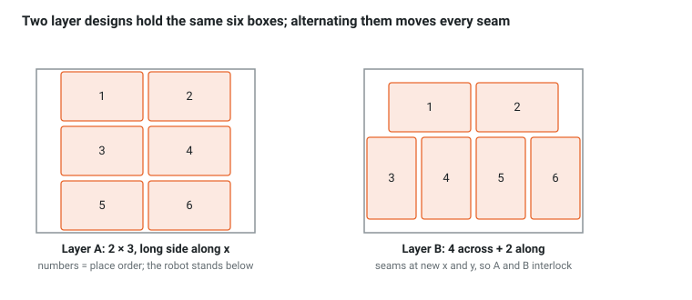

# Ch 12 — Single-SKU pallet patterns (week 8)

Goal: a header-only pattern generator (`cell_planning/patterns.hpp`) that turns a pallet size, a box size and a gap into layers, alternates two layer designs so the stack interlocks, and orders the placements so the arm never reaches over a box it just placed. Ch 14 feeds its output to the robot.

## Vocabulary

| Term | Meaning | In this tutorial |
| --- | --- | --- |
| Layer pattern | list of (x, y, yaw) for one layer in `pallet_frame` | `std::vector<Place>` |
| Column stacking | every layer identical; seams line up; fast but unstable | `stack(n)` with the same layer twice |
| Interlocking | alternate two patterns so seams land on box interiors | `stack(n)` alternates A and B |
| Utilization | box footprint area / deck area | `utilization()` |
| Overhang | how far a box may stick out past the deck edge | `fits(…, overhang)` |
| Place order | sequence within a layer: far side first, then toward the robot | `placeOrder()` |

## `cell_planning/include/cell_planning/patterns.hpp`

```cpp
#pragma once
#include <algorithm>
#include <array>
#include <cmath>
#include <utility>
#include <vector>
#include <cell_planning/geometry.hpp>
#include <cell_planning/grasps.hpp>      // BoxSize

namespace cell_planning {

// Layer patterns in pallet_frame: x along the 0.8 m side, y along the 0.6 m side, origin at the deck center.
constexpr std::array<double, 2> PALLET = {0.80, 0.60};     // x, y [m]
constexpr BoxSize SKU_A{0.30, 0.18, 0.15};                  // x, y, z [m]
constexpr double GAP = 0.02;

struct Place { double x, y, yaw; };   // box center in pallet_frame; yaw 0: box x along pallet x, pi/2: box x along pallet y
struct Row { int n; double yaw; };

/// Extent along pallet x and y for yaw 0 or pi/2.
inline std::pair<double, double> footprint(const BoxSize & box, double yaw) {
  return std::abs(yaw) < 1e-9 ? std::pair<double, double>{box.x, box.y} : std::pair<double, double>{box.y, box.x};
}

/// n boxes side by side along x, centered, all at row center y.
inline std::vector<Place> row(int n, double yaw, double y, const BoxSize & box = SKU_A, double gap = GAP) {
  const auto [w, d] = footprint(box, yaw);
  const double x0 = -(n * w + (n - 1) * gap) / 2;
  std::vector<Place> out;
  for (int i = 0; i < n; ++i) out.push_back({x0 + w / 2 + i * (w + gap), y, yaw});
  return out;
}

/// Rows stacked along y, the whole block centered on the deck.
inline std::vector<Place> layerFromRows(const std::vector<Row> & rows, const BoxSize & box = SKU_A, double gap = GAP) {
  double total = gap * (rows.size() - 1);
  for (const auto & r : rows) total += footprint(box, r.yaw).second;
  double y = -total / 2;
  std::vector<Place> places;
  for (const auto & r : rows) {
    const double d = footprint(box, r.yaw).second;
    for (const auto & p : row(r.n, r.yaw, y + d / 2, box, gap)) places.push_back(p);
    y += d + gap;
  }
  return places;
}

inline bool fits(const std::vector<Place> & places, const BoxSize & box = SKU_A, double overhang = 0.0) {
  for (const auto & p : places) {
    const auto [w, d] = footprint(box, p.yaw);
    if (std::abs(p.x) + w / 2 > PALLET[0] / 2 + overhang + 1e-9 || std::abs(p.y) + d / 2 > PALLET[1] / 2 + overhang + 1e-9) return false;
  }
  return true;
}

/// True if any two footprints intersect (yaw 0 / pi/2 only).
inline bool overlaps(const std::vector<Place> & places, const BoxSize & box = SKU_A) {
  for (std::size_t i = 0; i < places.size(); ++i) {
    const auto [wa, da] = footprint(box, places[i].yaw);
    for (std::size_t j = i + 1; j < places.size(); ++j) {
      const auto [wb, db] = footprint(box, places[j].yaw);
      if (std::abs(places[i].x - places[j].x) < (wa + wb) / 2 - 1e-9 && std::abs(places[i].y - places[j].y) < (da + db) / 2 - 1e-9) return true;
    }
  }
  return false;
}

inline double utilization(const std::vector<Place> & places, const BoxSize & box = SKU_A) {
  return places.size() * box.x * box.y / (PALLET[0] * PALLET[1]);
}

inline const std::vector<Place> & layerA() { static const auto L = layerFromRows({{2, 0.0}, {2, 0.0}, {2, 0.0}}); return L; }   // 2 x 3 grid, long side along x
inline const std::vector<Place> & layerB() { static const auto L = layerFromRows({{4, M_PI / 2}, {2, 0.0}}); return L; }       // 4 across + 2 along: the seams move

/// Alternate A and B so the vertical seams of one layer land on box interiors of the next.
inline std::vector<std::vector<Place>> stack(int layers) {
  std::vector<std::vector<Place>> s;
  for (int L = 0; L < layers; ++L) s.push_back(L % 2 ? layerB() : layerA());
  return s;
}

/// Far side first: the robot stands at negative y of the pallet, so place large y first.
inline std::vector<Place> placeOrder(std::vector<Place> layer) {
  std::sort(layer.begin(), layer.end(), [](const Place & a, const Place & b) { return a.y != b.y ? a.y > b.y : a.x < b.x; });
  return layer;
}

/// Pose of the box center in pallet_frame; layers rest directly on each other.
inline Isometry3d boxPose(const Place & p, int layer_index, const BoxSize & box = SKU_A) {
  return trans(p.x, p.y, layer_index * box.z + box.z / 2) * rotZ(p.yaw);
}

}  // namespace cell_planning
```

Layer A is exactly the scene `spawn_scene` builds (x = ±0.16, y = −0.2, 0, 0.2). Layer B puts four boxes across the near half and two along the far half; its seams fall at different x and y than A's. Both hold 6 boxes at 67 % utilization.



Stack A, B, A: no vertical seam continues through two layers, which is what keeps a column-stacked pallet from splitting under transport.

```cpp
// cell_planning/test/test_patterns.cpp   (add `ament_add_gtest(test_patterns test/test_patterns.cpp)` + link)
#include <gtest/gtest.h>
#include <cell_planning/patterns.hpp>

using namespace cell_planning;

TEST(Patterns, LayersAreValid) {
  for (const auto * L : {&layerA(), &layerB()}) { EXPECT_EQ(L->size(), 6u); EXPECT_TRUE(fits(*L)); EXPECT_FALSE(overlaps(*L)); }
}

TEST(Patterns, StackAlternates) {
  const auto s = stack(3);
  EXPECT_EQ(s[0][0].yaw, 0.0); EXPECT_EQ(s[1][0].yaw, M_PI / 2); EXPECT_EQ(s[2][0].yaw, 0.0);   // B starts with the rotated row
}

TEST(Patterns, PlaceOrderFarFirst) {
  const auto order = placeOrder(layerA());
  for (std::size_t i = 1; i < order.size(); ++i) EXPECT_GE(order[i - 1].y, order[i].y);
}

TEST(Patterns, BigSkuDoesNotFitWithGap) {
  const BoxSize C{0.40, 0.30, 0.20};
  EXPECT_FALSE(fits(layerFromRows({{2, 0.0}, {2, 0.0}}, C), C));   // 0.4 + 0.02 + 0.4 > 0.8
}
```

## See it

In C++ the natural viewer is RViz: a small node publishes both layers as markers in `pallet_frame`, layer A at the deck and layer B one layer up, with the placement order as text.

```cpp
// cell_planning/src/show_pattern.cpp   (add_executable + ament_target_dependencies(rclcpp visualization_msgs) + install)
#include <rclcpp/rclcpp.hpp>
#include <visualization_msgs/msg/marker_array.hpp>
#include <cell_planning/patterns.hpp>

using namespace cell_planning;

int main(int argc, char ** argv) {
  rclcpp::init(argc, argv);
  auto node = rclcpp::Node::make_shared("show_pattern");
  auto pub = node->create_publisher<visualization_msgs::msg::MarkerArray>("pattern/markers", rclcpp::QoS(1).transient_local());
  visualization_msgs::msg::MarkerArray arr;
  int id = 0;
  for (int L : {0, 1}) {
    const auto & layer = L ? layerB() : layerA();
    int order = 1;
    for (const auto & p : placeOrder(layer)) {
      visualization_msgs::msg::Marker m;
      m.header.frame_id = "pallet_frame"; m.ns = "pattern"; m.id = id++;
      m.type = m.CUBE; m.action = m.ADD;
      m.pose = poseFromMat(boxPose(p, L));
      m.scale.x = SKU_A.x; m.scale.y = SKU_A.y; m.scale.z = SKU_A.z;
      m.color.r = 0.91f; m.color.g = 0.38f; m.color.b = 0.15f; m.color.a = 0.8f;
      arr.markers.push_back(m);
      visualization_msgs::msg::Marker t = m;
      t.id = id++; t.type = t.TEXT_VIEW_FACING; t.text = std::to_string(order++);
      t.pose.position.z += SKU_A.z / 2 + 0.02; t.scale.z = 0.06; t.color.r = t.color.g = t.color.b = 1.0f;
      arr.markers.push_back(t);
    }
  }
  pub->publish(arr);                                  // latched: RViz gets it whenever it subscribes
  RCLCPP_INFO(node->get_logger(), "layers A (deck) and B (one layer up) published on pattern/markers");
  rclcpp::spin(node);
  rclcpp::shutdown();
}
```

Add a MarkerArray display on `pattern/markers` in RViz (Durability Policy: Transient Local). Numbers are the placement order; 1 is farthest from the robot.

Real cell: pattern design is usually a separate tool (a pattern editor or an optimizer) that outputs a pattern file per SKU. The planner in the cell only reads it. Overhang, interlock quality and the maximum stack height are typically customer rules, not computed on the fly.

## Checkpoint

- [ ] `colcon test --packages-select cell_planning` passes, including the four pattern tests
- [ ] `show_pattern` draws both layers in RViz; no box crosses the deck outline
- [ ] You designed a layer for SKU C (0.40 × 0.30) that fits with `GAP = 0.02` and wrote it as `layerFromRows(...)` (hint: rotate; 2 boxes across the 0.8 m side need 0.62 m)
- [ ] You wrote `seamOverlap(a, b)` that returns how much of layer B's seam length lies over a box interior of layer A, and confirmed it is higher for A/B than for A/A

## Questions

1. Why place the far rows first?
2. Layer B has four boxes rotated 90° on the near side. What changes in Ch 11's grasp when the pad has to place a rotated box?

Answers: [Appendix](appendix.html)
