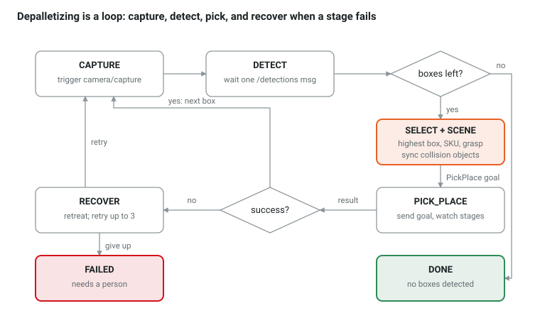

# Ch 13 — Depalletizing end-to-end: the task executive (week 8)

Goal: an `executive` node that runs a whole depalletizing job as a `RunJob` action: capture, detect, choose, keep the planning scene honest, pick and place, repeat, recover. One launch file starts the entire cell.

## The loop



Every transition is a line of code in `execute()` below; the executive is an explicit state machine, so the log of its states is the story of the job. Ch 17 shows the same logic as a behavior tree.

## What the executive knows

The executive holds **beliefs** and nothing else: the last detection frame, a SKU table, and its own record of what it placed where. In this chapter it drops boxes into three slots on the still conveyor and stacks two per slot (one layer of six). Ch 14 replaces the slots with a moving belt.

```cpp
// cell_planning/include/cell_planning/skus.hpp   (what a WMS would provide)
#pragma once
#include <algorithm>
#include <cmath>
#include <map>
#include <string>
#include <utility>
#include <cell_planning/grasps.hpp>      // BoxSize

namespace cell_planning {

inline const std::map<std::string, BoxSize> SKUS{{"A", {0.30, 0.18, 0.15}}, {"B", {0.20, 0.20, 0.12}}, {"C", {0.40, 0.30, 0.20}}};

/// Footprint lookup (the detector gives the long side first). Empty name = no match: measured footprint, default height.
inline std::pair<std::string, BoxSize> matchSku(double sx, double sy, double tol = 0.03) {
  for (const auto & [name, b] : SKUS)
    if (std::abs(sx - std::max(b.x, b.y)) <= tol && std::abs(sy - std::min(b.x, b.y)) <= tol) return {name, b};
  return {"", BoxSize{sx, sy, 0.15}};
}

}  // namespace cell_planning
```

## Planning scene sync: `cell_executive/include/cell_executive/scene.hpp`

```cpp
#pragma once
#include <set>
#include <string>
#include <rclcpp/rclcpp.hpp>
#include <moveit_msgs/msg/collision_object.hpp>
#include <shape_msgs/msg/solid_primitive.hpp>
#include <vision_msgs/msg/detection3_d_array.hpp>
#include <cell_planning/geometry.hpp>
#include <cell_planning/grasps.hpp>

namespace cell_executive {

/// Keeps move_group's world in sync with what the executive believes, via the /collision_object topic.
class Scene {
public:
  explicit Scene(rclcpp::Node & node, std::string frame = "pallet_frame") : node_(node), frame_(std::move(frame)) {
    pub_ = node.create_publisher<moveit_msgs::msg::CollisionObject>("collision_object", 10);
  }

  void add(const std::string & id, const Eigen::Isometry3d & T, const cell_planning::BoxSize & s, const std::string & frame = "") {
    auto co = msg(id, moveit_msgs::msg::CollisionObject::ADD, frame);
    shape_msgs::msg::SolidPrimitive box;
    box.type = box.BOX;
    box.dimensions = {s.x, s.y, s.z};
    co.primitives.push_back(box);
    co.primitive_poses.push_back(cell_planning::poseFromMat(T));
    pub_->publish(co);
    ids_.insert(id);
  }

  void remove(const std::string & id) { pub_->publish(msg(id, moveit_msgs::msg::CollisionObject::REMOVE)); ids_.erase(id); }

  void clear() { for (const auto & id : std::set<std::string>(ids_)) remove(id); }

  /// One box per detection plus a solid envelope for everything below the top layer.
  template <typename SizeOf>
  void sync(const vision_msgs::msg::Detection3DArray & dets, SizeOf sizeOf) {
    for (const auto & id : std::set<std::string>(ids_))
      if (id.rfind("det_", 0) == 0 || id == "stack") remove(id);
    double z_top = 0.0, tallest = 0.0;
    for (const auto & d : dets.detections) {
      const cell_planning::BoxSize s = sizeOf(d);
      const double top = d.bbox.center.position.z + d.bbox.size.z / 2;
      Eigen::Isometry3d T = cell_planning::matFromPose(d.bbox.center);
      T.translation().z() = top - s.z / 2;                               // re-center with the SKU height
      add(d.id, T, s);
      z_top = std::max(z_top, top);
      tallest = std::max(tallest, s.z);
    }
    const double below = z_top - tallest;
    if (below > 0.01)                                                    // we cannot see under the top layer
      add("stack", cell_planning::trans(0.0, 0.0, below / 2), {0.8, 0.6, below});
  }

private:
  moveit_msgs::msg::CollisionObject msg(const std::string & id, int8_t op, const std::string & frame = "") {
    moveit_msgs::msg::CollisionObject co;
    co.id = id;
    co.operation = op;
    co.header.frame_id = frame.empty() ? frame_ : frame;
    co.header.stamp = node_.now();
    return co;
  }

  rclcpp::Node & node_;
  std::string frame_;
  rclcpp::Publisher<moveit_msgs::msg::CollisionObject>::SharedPtr pub_;
  std::set<std::string> ids_;
};

}  // namespace cell_executive
```

## `cell_executive/src/executive.cpp`

```cpp
#include <algorithm>
#include <chrono>
#include <map>
#include <mutex>
#include <optional>
#include <string>
#include <thread>
#include <rclcpp/rclcpp.hpp>
#include <rclcpp_action/rclcpp_action.hpp>
#include <std_srvs/srv/trigger.hpp>
#include <vision_msgs/msg/detection3_d_array.hpp>
#include <tf2_ros/buffer.h>
#include <tf2_ros/transform_listener.h>
#include <cell_interfaces/action/pick_place.hpp>
#include <cell_interfaces/action/run_job.hpp>
#include <cell_planning/geometry.hpp>
#include <cell_planning/grasps.hpp>
#include <cell_planning/skus.hpp>
#include <cell_executive/scene.hpp>

using namespace std::chrono_literals;
using namespace cell_planning;
using PickPlace = cell_interfaces::action::PickPlace;
using RunJob = cell_interfaces::action::RunJob;
using JobHandle = rclcpp_action::ServerGoalHandle<RunJob>;
using Dets = vision_msgs::msg::Detection3DArray;

static const Isometry3d CONVEYOR_TOP = trans(-0.9, 0.0, 0.70);     // belt surface at the photo-eye, world frame
static const std::vector<double> DROP_SLOTS = {0.0, 0.4, -0.4};     // y offsets along the belt; Ch 14 deletes these

static geometry_msgs::msg::PoseStamped stamped(const Isometry3d & T, const std::string & frame = "world") {
  geometry_msgs::msg::PoseStamped p; p.header.frame_id = frame; p.pose = poseFromMat(T); return p;
}

/// Beliefs only: the last detection frame, the SKU table, and what it placed where. It never reads world_model.
class Executive : public rclcpp::Node {
public:
  Executive() : Node("executive"), buf_(get_clock()), listener_(buf_), scene_(*this) {
    cb_ = create_callback_group(rclcpp::CallbackGroupType::Reentrant);
    capture_ = create_client<std_srvs::srv::Trigger>("camera/capture", rmw_qos_profile_services_default, cb_);
    pick_place_ = rclcpp_action::create_client<PickPlace>(this, "pick_place", cb_);
    rclcpp::SubscriptionOptions so; so.callback_group = cb_;
    sub_ = create_subscription<Dets>("detections", 10, [this](Dets::ConstSharedPtr m) { std::lock_guard<std::mutex> l(mtx_); frame_ = m; }, so);
    server_ = rclcpp_action::create_server<RunJob>(
      this, "run_job",
      [](const rclcpp_action::GoalUUID &, RunJob::Goal::ConstSharedPtr) { return rclcpp_action::GoalResponse::ACCEPT_AND_EXECUTE; },
      [](std::shared_ptr<JobHandle>) { return rclcpp_action::CancelResponse::ACCEPT; },
      [this](std::shared_ptr<JobHandle> gh) { std::thread([this, gh]() { execute(gh); }).detach(); },
      rcl_action_server_get_default_options(), cb_);
    for (double s : DROP_SLOTS) placed_[s] = 0;                        // belief: boxes per slot
  }

private:
  // ---- waiting from the job thread: the executor keeps serving callbacks meanwhile ----
  bool capture() {
    auto fut = capture_->async_send_request(std::make_shared<std_srvs::srv::Trigger::Request>());
    return fut.wait_for(15s) == std::future_status::ready;
  }
  void clearFrame() { std::lock_guard<std::mutex> l(mtx_); frame_.reset(); }
  std::optional<Dets> waitFrame(std::chrono::milliseconds timeout) {     // checks at least once, even with 0 ms
    const auto t0 = std::chrono::steady_clock::now();
    do {
      { std::lock_guard<std::mutex> l(mtx_); if (frame_) return *frame_; }
      std::this_thread::sleep_for(50ms);
    } while (std::chrono::steady_clock::now() - t0 < timeout);
    return std::nullopt;
  }
  /// Sends a PickPlace goal and waits for it. Returns (success, message).
  std::pair<bool, std::string> runPick(const PickPlace::Goal & goal) {
    rclcpp_action::Client<PickPlace>::SendGoalOptions opts;
    opts.feedback_callback = [this](auto, PickPlace::Feedback::ConstSharedPtr f) { onStage(*f); };
    auto gh_fut = pick_place_->async_send_goal(goal, opts);
    if (gh_fut.wait_for(10s) != std::future_status::ready || !gh_fut.get()) return {false, "pick_place rejected the goal"};
    auto res_fut = pick_place_->async_get_result(gh_fut.get());
    if (res_fut.wait_for(180s) != std::future_status::ready) return {false, "pick_place timeout"};
    const auto r = res_fut.get();
    return {r.result && r.result->success, r.result ? r.result->message : "no result"};
  }
  void onStage(const PickPlace::Feedback & f) { RCLCPP_INFO(get_logger(), "   %s", f.stage.c_str()); }

  // ---- the loop ----
  void execute(std::shared_ptr<JobHandle> gh) {
    auto fb = std::make_shared<RunJob::Feedback>();
    auto res = std::make_shared<RunJob::Result>();
    const auto & req = *gh->get_goal();
    std::string state = "CAPTURE";
    int moved = 0, retries = 0;
    Dets dets;
    std::optional<PickPlace::Goal> goal;
    scene_.clear();
    while (true) {
      fb->state = state; fb->boxes_moved = moved; gh->publish_feedback(fb);
      RCLCPP_INFO(get_logger(), "[%d] %s", moved, state.c_str());
      if (gh->is_canceling()) { res->boxes_moved = moved; res->message = "cancelled"; gh->canceled(res); return; }

      if (state == "CAPTURE") {
        clearFrame();
        if (!capture()) { last_error_ = "camera timeout"; state = "RECOVER"; continue; }
        state = "DETECT";
      } else if (state == "DETECT") {
        const auto f = waitFrame(2s);
        if (!f) { last_error_ = "no detections"; state = "RECOVER"; continue; }
        dets = *f;
        if (dets.detections.empty() || (req.max_boxes >= 0 && moved >= req.max_boxes)) { state = "DONE"; continue; }
        state = "SELECT";
      } else if (state == "SELECT") {
        goal = planPick(dets);
        state = goal ? "PICK_PLACE" : "DONE";
      } else if (state == "PICK_PLACE") {
        const auto [ok, msg] = runPick(*goal);
        if (ok) { ++moved; retries = 0; recordPlace(*goal); state = "CAPTURE"; }
        else { last_error_ = msg; state = "RECOVER"; }
      } else if (state == "RECOVER") {
        ++retries;
        RCLCPP_ERROR(get_logger(), "recover (%d/3): %s", retries, last_error_.c_str());
        if (last_error_.find("still holding") != std::string::npos || retries > 3) { state = "FAILED"; continue; }
        state = "CAPTURE";
      } else {                                                          // DONE or FAILED
        res->success = state == "DONE"; res->boxes_moved = moved; res->message = state;
        if (res->success) gh->succeed(res); else gh->abort(res);
        return;
      }
    }
  }

  /// Highest box first; SKU height overrides the detector's; refuse risky grasps.
  std::optional<PickPlace::Goal> planPick(const Dets & dets) {
    auto top = [](const vision_msgs::msg::Detection3D & d) { return d.bbox.center.position.z + d.bbox.size.z / 2; };
    const auto & d = *std::max_element(dets.detections.begin(), dets.detections.end(),
                                       [&](const auto & a, const auto & b) { return top(a) < top(b); });   // highest top face
    const auto [sku, size] = matchSku(d.bbox.size.x, d.bbox.size.y);
    auto sizeOf = [](const vision_msgs::msg::Detection3D & o) { return matchSku(o.bbox.size.x, o.bbox.size.y).second; };
    Isometry3d T_box = matFromPose(d.bbox.center);
    T_box.translation().z() = top(d) - size.z / 2;
    std::vector<Neighbor> others;
    for (const auto & o : dets.detections) if (o.id != d.id) others.push_back({matFromPose(o.bbox.center), sizeOf(o)});
    const auto [risk, T_pick] = bestGrasp(T_box, size, others);
    if (risk > 0.1) { RCLCPP_WARN(get_logger(), "%s: double-pick risk %.2f, skipping", d.id.c_str(), risk); return std::nullopt; }
    const double slot = std::min_element(placed_.begin(), placed_.end(), [](const auto & a, const auto & b) { return a.second < b.second; })->first;
    if (placed_[slot] >= 2) { RCLCPP_WARN(get_logger(), "drop slots full"); return std::nullopt; }
    scene_.sync(dets, sizeOf);
    const Isometry3d T_wp = tf2::transformToEigen(buf_.lookupTransform("world", "pallet_frame", tf2::TimePointZero, tf2::durationFromSec(1.0)));
    const Isometry3d T_place = CONVEYOR_TOP * trans(0.0, slot, placed_[slot] * size.z + size.z) * rotX(M_PI);
    PickPlace::Goal g;
    g.box_id = d.id;
    g.pick_pose = stamped(T_wp * T_pick);
    g.place_pose = stamped(T_place);
    g.box_size.x = size.x; g.box_size.y = size.y; g.box_size.z = size.z;
    RCLCPP_INFO(get_logger(), "%s: sku '%s' risk %.2f -> slot y=%.1f", d.id.c_str(), sku.c_str(), risk, slot);
    return g;
  }

  /// Belief update: the box now sits in its slot; the planner must avoid it.
  void recordPlace(const PickPlace::Goal & g) {
    const double slot = std::round(g.place_pose.pose.position.y * 100) / 100;
    placed_[slot] += 1;
    const Isometry3d T = matFromPose(g.place_pose.pose) * trans(0.0, 0.0, g.box_size.z / 2);   // from TCP at the top to the center
    scene_.add("placed_" + std::to_string(slot) + "_" + std::to_string(placed_[slot]), T,
               {g.box_size.x, g.box_size.y, g.box_size.z}, "world");
  }

  rclcpp::CallbackGroup::SharedPtr cb_;
  rclcpp::Client<std_srvs::srv::Trigger>::SharedPtr capture_;
  rclcpp_action::Client<PickPlace>::SharedPtr pick_place_;
  rclcpp::Subscription<Dets>::SharedPtr sub_;
  rclcpp_action::Server<RunJob>::SharedPtr server_;
  tf2_ros::Buffer buf_;
  tf2_ros::TransformListener listener_;
  cell_executive::Scene scene_;
  std::mutex mtx_;
  Dets::ConstSharedPtr frame_;
  std::map<double, int> placed_;
  std::string last_error_;
};

int main(int argc, char ** argv) {
  rclcpp::init(argc, argv);
  auto node = std::make_shared<Executive>();
  rclcpp::executors::MultiThreadedExecutor ex(rclcpp::ExecutorOptions(), 4);
  ex.add_node(node);
  ex.spin();
  rclcpp::shutdown();
}
```

```cmake
# cell_executive/CMakeLists.txt
cmake_minimum_required(VERSION 3.8)
project(cell_executive)
set(CMAKE_CXX_STANDARD 17)

find_package(ament_cmake REQUIRED)
find_package(rclcpp REQUIRED)
find_package(rclcpp_action REQUIRED)
find_package(std_srvs REQUIRED)
find_package(vision_msgs REQUIRED)
find_package(moveit_msgs REQUIRED)
find_package(shape_msgs REQUIRED)
find_package(tf2_ros REQUIRED)
find_package(tf2_eigen REQUIRED)
find_package(cell_interfaces REQUIRED)
find_package(cell_planning REQUIRED)

add_executable(executive src/executive.cpp)
target_include_directories(executive PUBLIC include)
ament_target_dependencies(executive rclcpp rclcpp_action std_srvs vision_msgs moveit_msgs shape_msgs tf2_ros tf2_eigen cell_interfaces)
target_link_libraries(executive cell_planning::cell_planning)

install(TARGETS executive DESTINATION lib/${PROJECT_NAME})
install(DIRECTORY include/ DESTINATION include)
ament_package()
```

The TCP z axis points into the box, so `place_pose * trans(0, 0, +h/2)` is the box center: the same sign convention as `offset()` in Ch 11. The job runs in its own thread (`execute` is started from the accept callback), so every wait in it is a plain `future.wait_for` or a sleep while the executor's four threads keep serving feedback, the detection subscription and the action protocol.

## One launch file for the cell: `cell_bringup/launch/cell.launch.py`

```python
from launch import LaunchDescription
from launch.actions import IncludeLaunchDescription
from launch.launch_description_sources import PythonLaunchDescriptionSource
from launch_ros.actions import Node
from launch_ros.substitutions import FindPackageShare

def include(pkg, name, **args):
    return IncludeLaunchDescription(PythonLaunchDescriptionSource([FindPackageShare(pkg), '/launch/', name]),
                                    launch_arguments=args.items())

def generate_launch_description():
    return LaunchDescription([
        include('cell_moveit_config', 'demo.launch.py'),          # robot, controllers, move_group, RViz
        include('cell_sim', 'twin.launch.py'),                    # world_model, mock_gripper, mock_camera
        Node(package='cell_perception', executable='box_detector', output='screen'),
        Node(package='cell_motion', executable='pick_place_server', output='screen'),
        Node(package='cell_executive', executable='executive', output='screen'),
    ])
```

Set `continuous_hz: 0.0` for the camera in `twin.launch.py` now: the executive triggers captures itself, like a real cell.

## Run a job

```bash
ros2 launch cell_bringup cell.launch.py
ros2 run cell_sim spawn_scene --scene single_sku --layers 1
ros2 action send_goal /run_job cell_interfaces/action/RunJob "{mode: depalletize, strategy: single_sku}" --feedback
```

Feedback walks through `CAPTURE, DETECT, SELECT, PICK_PLACE` six times, then `DONE` with `boxes_moved: 6`. In RViz the planning scene shows green detection boxes, the envelope under them (none for one layer), the attached box during transit and the placed boxes growing in three stacks on the belt.

Real cell: this node is the "task layer" of any palletizing controller. In a Mujin-style system the same loop exists, with the planning scene and the belief state inside the controller's own environment model, and a far richer recovery vocabulary. The interfaces around it (capture, detections, pick/place, I/O) are what you have just built.

## Checkpoint

- [ ] A one-layer job finishes with `boxes_moved: 6` and the pallet is empty in the mock camera's next cloud
- [ ] Cancelling the goal (Ctrl-C on `send_goal`) stops after the current pick; the robot is not left mid-motion
- [ ] Stop `mock_gripper` mid-job: the executive reports `no vacuum`, retries three times, then returns `FAILED`
- [ ] Spawn two layers: the second job call reports `drop slots full` after the first six; you can explain why the executive, not the world model, knows that
- [ ] You added a `'stack'` envelope check: with two layers the planner refuses a path that passes through the lower layer (set a deliberately low approach distance to provoke it)

## Questions

1. Why does `planPick` re-center the box with the SKU height instead of trusting `bbox.size.z`?
2. The executive calls services and actions from inside its own action callback. Which two Ch 1 facts make that safe?

Answers: [Appendix](appendix.html)

## Go deeper: capture while the robot carries the box

The loop above captures only after RETREAT, so the camera and the robot take turns. Camera vendors recommend the opposite: trigger the capture as soon as the arm has lifted the box clear of the camera's view, so the next detection is ready when the place finishes ([Zivid, optimizing robot cycle times](https://support.zivid.com/en/latest/camera/academy/applications/depalletization/optimize-robot-cycle-times.html)). In this cell the mock camera never sees the arm, so the change is a few lines:

```cpp
  // in the PickPlace feedback callback: the pallet is free once the box is lifted
  void onStage(const PickPlace::Feedback & f) {
    RCLCPP_INFO(get_logger(), "   %s", f.stage.c_str());
    if (f.stage == "TRANSIT" && mode_ == "depalletize") {     // mode_: a member set at the start of execute()
      clearFrame();
      capture_->async_send_request(std::make_shared<std_srvs::srv::Trigger::Request>());
    }
  }
  // in PICK_PLACE, on success (depalletize):
  state = waitFrame(0ms) ? "DETECT" : "CAPTURE";
```

Measure seconds per box before and after; on a real cell this is worth about one capture-and-detect time per pick, which is often 0.5–1 s.

Also worth knowing: MoveIt's [perception pipeline](https://github.com/ros-planning/moveit2_tutorials/blob/main/doc/examples/examples.rst) can build an octomap collision model straight from `/camera/points`, which replaces the hand-made `stack` envelope with the true shape of everything the camera sees. It costs planning time and needs a camera that also sees the sides of the stack, so this tutorial keeps the envelope.
