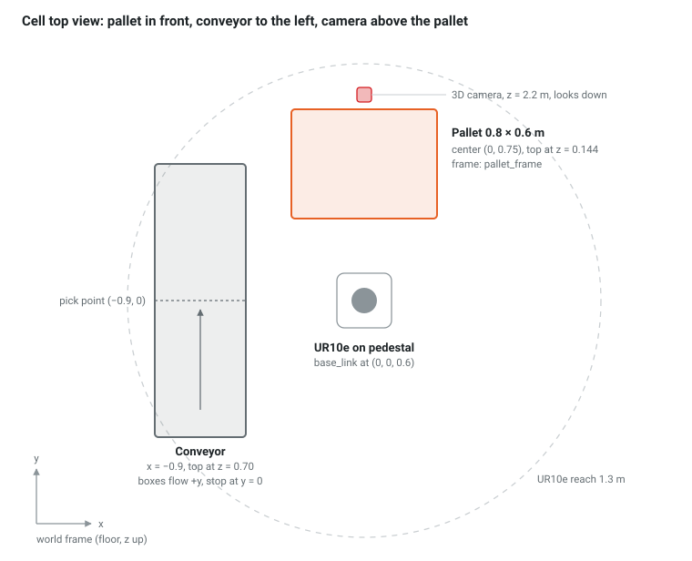
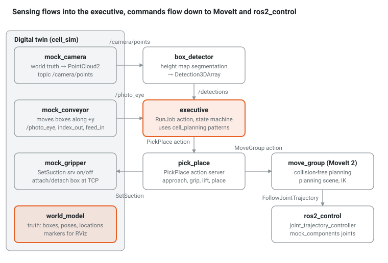

# ROS 2 Palletizing & Depalletizing — 12-Week Hands-On Tutorial (C++ edition)

By week 12 you will run a UR10e that depalletizes and palletizes single-SKU and mixed-SKU boxes in a fully mocked cell: synthetic 3D camera, mocked robot joints, mocked suction and conveyor, all inside a VM. Every chapter is self-contained, ends with a checkpoint, and builds one piece of the final system.

Prerequisites: comfortable C++17, a basic Linux shell, and the linear algebra of 4 × 4 transforms (refreshed in Ch 4). No prior ROS is assumed.

**Language rule.** Every node and library the robot software is made of is C++: `rclcpp`, Eigen, OpenCV, MoveIt's `MoveGroupInterface`, BehaviorTree.CPP. Python remains only where production cells keep it too: the mock devices of the digital twin (Ch 8, 9, 14), launch files and launch tests.

## Target stack

| Layer | Choice | Why |
| --- | --- | --- |
| ROS 2 | Jazzy Jalisco on Ubuntu 24.04 (arm64 for UTM on Apple Silicon, amd64 for KVM) | LTS until May 2029; MoveIt 2, UR packages and most online answers target it. Lyrical Luth (May 2026, Ubuntu 26.04) also works: replace `jazzy` with `lyrical` once downstream packages are released there. |
| Robot model | UR10e from `ur_description` + a suction gripper you write in Xacro | Real industrial kinematics, 1.3 m reach, no driver or network needed |
| Motion | ros2_control mock hardware → MoveIt 2 (OMPL + Pilz planners) | Identical stack to a real UR driver; only the hardware plugin changes |
| Vision | Mock camera node publishing `sensor_msgs/PointCloud2`; height-map box detector you write | Swap the mock node for a real camera driver later |
| Task logic | C++ (rclcpp) throughout the robot software; MoveGroupInterface, Eigen, OpenCV, BehaviorTree.CPP optional | What production cells run |
| Physics | None by default (kinematic digital twin in RViz); Gazebo in Ch 17 | VM-friendly, deterministic |

## The cell you build

One UR10e on a 0.6 m pedestal, a half pallet (0.8 × 0.6 m) in front of it, a conveyor to its left, a 3D camera above the pallet. Depalletizing moves boxes pallet → conveyor; palletizing moves them conveyor → pallet. All positions are in the `world` frame on the floor; the pallet and conveyor frames are children of it (Ch 4).





RViz subscribes to joint states, TF, markers and the point cloud. The digital twin is the only part you swap when you go real.

## Workspace layout

All code lives in one colcon workspace. Each package appears in the chapter that introduces it.

```text
~/pal_ws/src/
├── cell_interfaces/      # Box.msg, PickPlace.action, SetSuction.srv …   (Ch 2)
├── cell_description/     # URDF/Xacro of robot + gripper + pallet + conveyor (Ch 3)
├── cell_moveit_config/   # generated by MoveIt Setup Assistant            (Ch 6)
├── cell_sim/             # Python twin: world_model, mock_gripper, mock_camera, mock_conveyor (Ch 8, 9, 14)
├── cell_perception/      # box_detector: point cloud → Detection3DArray   (Ch 10)
├── cell_planning/        # header-only C++: geometry, grasps, patterns, SKUs, mixed placement (Ch 4, 11–15)
├── cell_motion/          # Robot over MoveGroupInterface, pick_place action server (Ch 7, 11)
├── cell_executive/       # job state machine, RunJob action, BT sketch    (Ch 13–17)
└── cell_bringup/         # launch files that start everything             (Ch 13)
```

## 12-week plan (about 2 h/day, 5 days/week)

| Week | Chapters | After this week you can |
| --- | --- | --- |
| 1 | [Ch 0](ch00.html) · [Ch 1](ch01.html) | Run ROS 2 in the VM; write nodes with topics, services, actions |
| 2 | [Ch 2](ch02.html) · [Ch 3](ch03.html) | Define custom messages; show the whole cell in RViz |
| 3 | [Ch 4](ch04.html) · [Ch 5](ch05.html) | Reason about frames with TF2; move mocked joints with ros2_control |
| 4 | [Ch 6](ch06.html) · [Ch 7](ch07.html) | Plan collision-free motions with MoveIt from C++ |
| 5 | [Ch 8](ch08.html) · [Ch 9](ch09.html) | Run the digital twin: boxes, mock suction, synthetic point clouds |
| 6 | [Ch 10](ch10.html) | Detect boxes from point clouds with a height map |
| 7 | [Ch 11](ch11.html) | Generate pick poses, keep the planning scene in sync, attach boxes |
| 8 | [Ch 12](ch12.html) · [Ch 13](ch13.html) | Generate single-SKU pallet patterns; depalletize end-to-end |
| 9 | [Ch 14](ch14.html) | Palletize end-to-end with a mock conveyor and I/O |
| 10 | [Ch 15](ch15.html) | Handle mixed SKUs: online placement and pick ordering |
| 11 | [Ch 16](ch16.html) | Recover from errors; replay rosbags as mock data; test the logic |
| 12 | [Ch 17](ch17.html) · [Ch 18](ch18.html) | Add Gazebo physics or behavior trees; map every mock to a real cell |
| Reference | [Appendix](appendix.html) · [Reading list](reading-list.html) | Look up answers, commands, fixes and the sources each chapter builds on |

## Conventions

- Each chapter follows the same shape: Goal → Concepts → Build → Run → Checkpoint.
- Commands assume `~/pal_ws` with `source install/setup.bash` already done; the `$` prompt is omitted.
- Code blocks are complete files unless marked `// …`. Build after every chapter with `colcon build --symlink-install`.
- Checkpoints are tasks you tick off plus questions; answers are in the Appendix.
- Paragraphs marked `Real cell:` explain what replaces the mock in a production system like the ones you work with.
- This repository holds one tag per chapter and the final code on `master`: `git checkout ch05` shows the workspace as it should look after Ch 5, checkpoint exercises included.
